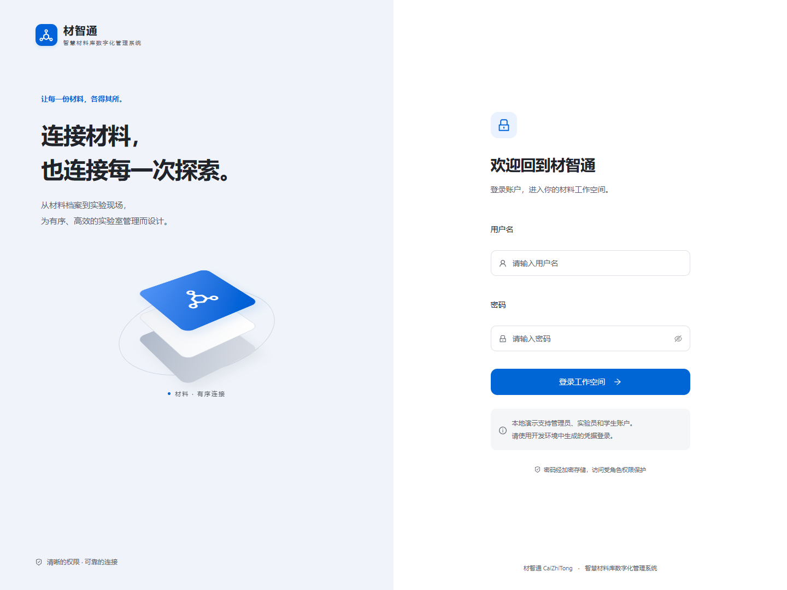
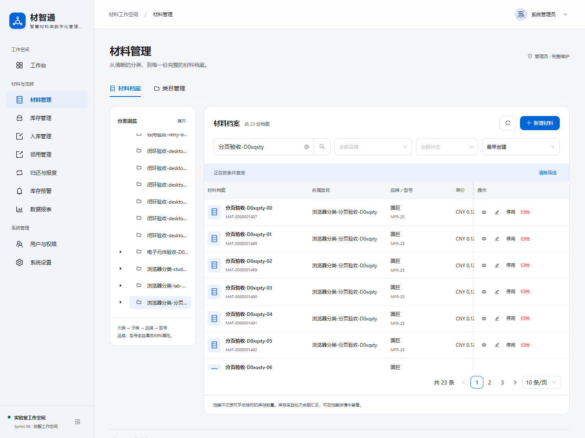
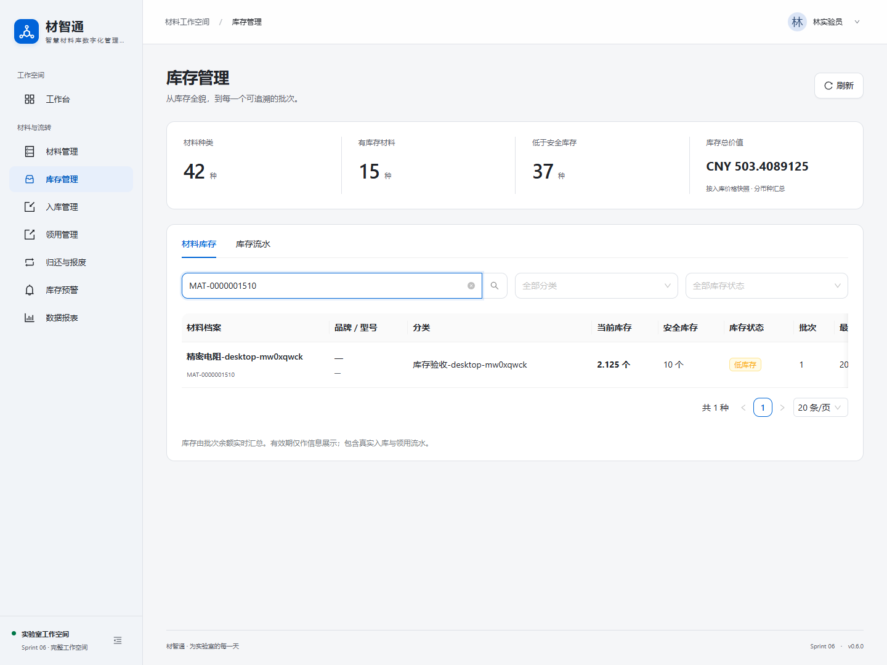
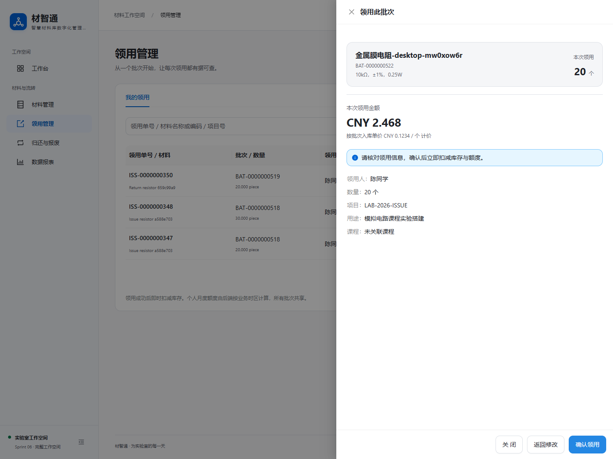
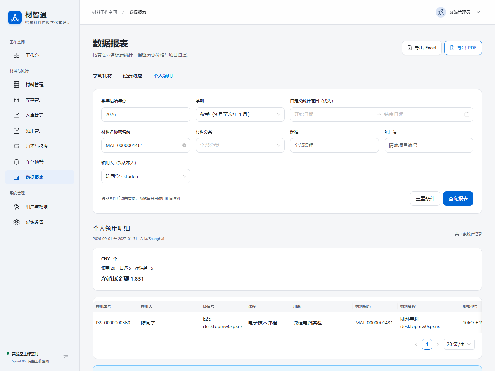
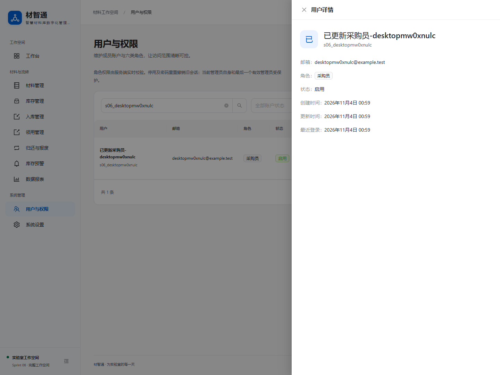
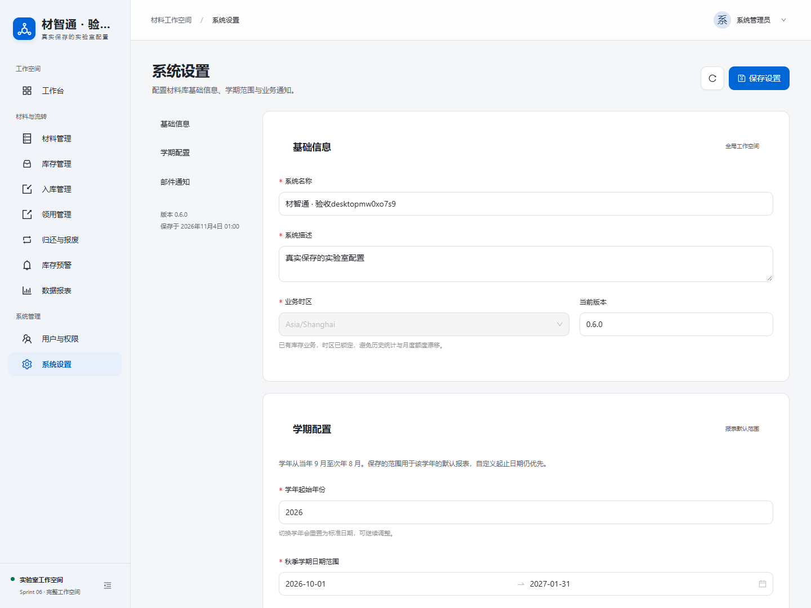
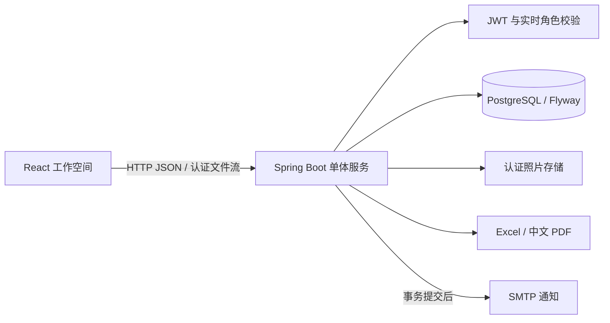
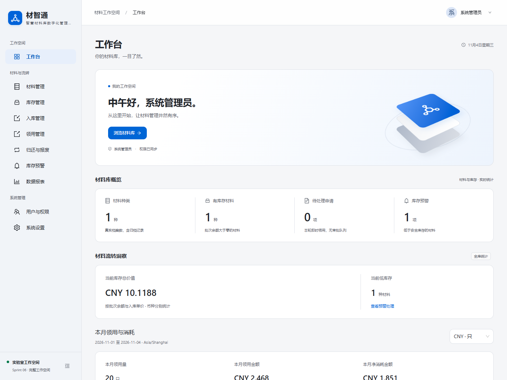

# 材智通 CaiZhiTong

面向高校实验室的智慧材料库数字化管理系统。以 React、Spring Boot 和 PostgreSQL 连接材料档案、入库、领用、归还报废、预警与报表，提供可追溯、可本地演示的完整业务闭环。

**开发版本：v0.7.0 · GitHub OAuth 与只读公开体验。** 本分支新增稳定 GitHub 身份关联与安全 JWT 交接；生产 OAuth 尚待账户持有人创建 OAuth App 并完成配置。原 v0.6.0 已完成 Sprint 01–06 人工验收和云端部署，用户名密码登录继续保留。

**在线体验：[打开材智通](https://caizhitong-eight.vercel.app)** · [后端健康检查](https://caizhitong-api.onrender.com/actuator/health)。请使用管理员分配的账户；公网环境不提供本地演示密码。免费后端休眠后首次连接可能需要 2–3 分钟。

[](https://github.com/JouCristian/CaiZhiTong/actions/workflows/ci.yml)


[本地运行](#本地运行) · [接口与权限](docs/API.md) · [最终验收](docs/FINAL-ACCEPTANCE.md) · [开发记录](docs/DEVELOPMENT.md) · [发布说明](docs/DEPLOYMENT.md)

## 功能特色

- **完整材料闭环**：分类与档案、入库批次、领用、归还报废、预警及报表真实关联。
- **数据可追溯**：精确十进制金额、原价格快照、不可变库存流水与持久幂等，重复提交不重复计量。
- **角色与隐私**：六类角色、服务端实时授权、旧会话撤销；学生仅访问本人私有业务。
- **GitHub 只读体验**：OAuth2 授权码、state / PKCE、60 秒浏览器绑定交换码；首次登录仅 GUEST，不按邮箱或用户名合并已有账户。需先完成[OAuth App 配置](docs/V0.7.0-GITHUB-OAUTH.md)。
- **统一工作空间**：Apple 风格浅色界面、响应式表单与移动卡片，空状态忠实反映数据库。

## 功能清单

| 模块 | 已实现能力 |
| --- | --- |
| 认证与权限 | BCrypt、JWT、每请求实时授权；停用和密码重置撤销旧会话 |
| 工作台 | 库存价值、本月领用与净消耗、TOP10、趋势、资金占比及授权排行榜 |
| 材料管理 | 分类树、材料档案、启停归档、服务端筛选分页 |
| 库存与入库 | 多明细入库、批次余额、价格快照、不可变流水、二维码与标签打印 |
| 领用管理 | 批次扣减、自然月额度、本人 / 全量历史、中文 PDF 凭证 |
| 归还与报废 | 完好材料多次归还原批次、仓库报废、认证照片、事务与幂等 |
| 库存预警 | 周期预警、确认备注、自动恢复、扫描、提交后 SMTP 与结果追踪 |
| 数据报表 | 学期耗材 / 经费对应 / 个人明细预览及全部六种 Excel / PDF 导出 |
| 用户与权限 | 新增编辑、六类角色、邮箱、启停、密码重置、最近登录、管理员保护 |
| 系统设置 | 品牌、时区、学期范围、通知收件人、邮件状态与最近结果 |

界面采用独立品牌与 Apple 风格浅色工作空间，统一系统蓝、圆角和克制动效；桌面高效操作，移动端使用卡片、响应式表单与抽屉。不使用 Apple Logo 或品牌资源。

六类角色为游客、学生、实验员、教师、采购员、系统管理员。学生只查看本人领用、归还与个人报表；个人排行榜仅管理员 / 实验员可见。前端导航与后端授权共同生效。

## 核心界面

<details>
<summary>展开八个核心界面：登录、工作台、材料、库存、领用、报表、用户、设置</summary>

| 登录 | 工作台 |
| --- | --- |
|  |  |
| 材料管理 | 库存管理 |
|  |  |
| 领用 | 报表 |
|  |  |
| 用户与权限 | 系统设置 |
|  |  |

</details>

更多真实截图：[系统设置](docs/screenshots/sprint06-settings-desktop.png)、[学生工作台](docs/screenshots/sprint06-dashboard-personal-mobile.png)、[数据报表](docs/screenshots/sprint05-reports-desktop.png)、[日常零数据工作台](docs/screenshots/sprint06-dashboard-empty-desktop.png)。业务截图来自真实浏览器与隔离 PostgreSQL 测试业务，日常环境不会自动拥有这些验收数据；零数据截图则来自日常环境。[各轮开发记录](docs/DEVELOPMENT.md)保留完整截图入口。

## 技术栈与架构

| 层次 | 技术 |
| --- | --- |
| 前端 | React 19、TypeScript 5.9、Vite 7、Ant Design 5、React Router 7、Decimal.js |
| 后端 | Java 17、Spring Boot 3.5、Spring Security、JWT、MyBatis-Plus、Spring JDBC |
| 数据 | PostgreSQL 15、Flyway V1–V6、NUMERIC / BigDecimal |
| 文件与通知 | Apache POI、PDFBox、OFL 中文字体、ZXing、ImageIO / WebP、Jakarta Mail |
| 验证 | JUnit / MockMvc、真实 PostgreSQL、Playwright 桌面 / 移动浏览器 |



既有 CRUD 使用 MyBatis-Plus，聚合与运维 Mapper 使用同一数据源的预编译 JdbcTemplate SQL，共享 Spring 事务。无需 Redis、消息队列或微服务。

```text
frontend/       页面、主题、认证与浏览器测试
backend/        Controller / Service / Mapper、DTO、迁移与集成测试
scripts/        PowerShell 启动、便携数据库、隔离测试和 HTTP 冒烟
database/       数据库说明及开发演示档案
docs/           API、验收、Sprint 历史、真实截图与报表示例
.github/        PostgreSQL 集成测试与前端构建 CI
```

## 本地运行

要求：Windows PowerShell 5.1+（推荐 7）、Node.js 22.12+ / 24、JDK 17、PostgreSQL 15。已验证 Node.js **24.22.1**、OpenLogic OpenJDK **17.0.20+8**、PostgreSQL **15.15**。提供 Maven 3.9.16 Wrapper（Windows / Unix）；便携 PostgreSQL 可替代 Docker。

### 首次准备

先克隆源码并进入项目目录：

```powershell
git clone https://github.com/JouCristian/CaiZhiTong.git
Set-Location ./CaiZhiTong
```

```powershell
# 克隆仓库后，在项目根目录执行。
Set-ExecutionPolicy -Scope Process Bypass
# JAVA_HOME 应指向你自己的 JDK 17 安装目录。
$env:Path = "$env:JAVA_HOME/bin;$env:Path"
./scripts/setup-local.ps1
Copy-Item ./frontend/.env.example ./frontend/.env
npm.cmd --prefix frontend ci
./scripts/portable-postgres.ps1 start
```

setup-local 保留已有 `.env`，首次生成本地随机数据库密码、JWT 密钥与演示密码。已有项目无需重复复制前端配置。也可使用 `docker compose up -d`，与便携实例二选一，避免争用 5432。

### 启动

第一个 PowerShell 窗口，在项目根目录：

```powershell
./scripts/start-backend.ps1
```

第二个窗口：

```powershell
Set-Location ./frontend
npm.cmd run dev
```

- 前端：[http://127.0.0.1:5173](http://127.0.0.1:5173)
- 健康检查：[http://127.0.0.1:8080/actuator/health](http://127.0.0.1:8080/actuator/health)

服务已运行时直接访问，不要重复启动。修改环境配置后重启对应服务；关闭时在启动终端 Ctrl+C。数据库使用 `scripts/portable-postgres.ps1 stop` 或 `docker compose stop`，保留数据。Windows 重打包运行中的同名 JAR 前需先停止对应进程，或使用 Maven 开发启动方式。

本机 Node 24.15 曾出现 Vite 进程原生 `0xC0000409` 退出，包含开发及预览进程；应先升级到较新的稳定 Node 补丁版，并用 `node --version` 确认启动终端生效。也可在停止前端后使用本地生产资源预览（仍连接真实后端）：

```powershell
# 从项目根目录进入前端。
Set-Location ./frontend
npm.cmd run build
npm.cmd run preview -- --port 5173 --strictPort
```

Vite preview 继承本地 `/api` 代理；这仅供本地验收，实际托管按部署说明配置。本次最终演示在 5173 使用生产资源预览，后端运行已验证的 0.6.0 JAR。

### 演示账户

| 用户名 | 角色 | 本地密码变量 |
| --- | --- | --- |
| admin | 系统管理员 | DEMO_ADMIN_PASSWORD |
| lab | 实验员 | DEMO_LAB_PASSWORD |
| student | 学生 | DEMO_STUDENT_PASSWORD |

在自己的终端查看：

```powershell
Get-Content ./.env | Select-String '^DEMO_(ADMIN|LAB|STUDENT)_PASSWORD='
```

仅 dev profile 且 DEMO_ENABLED=true 时初始化缺失账户，不覆盖已有密码或角色。管理员重置后使用新密码；修改环境变量不会重置已有账户。日常库不自动插入业务数据，可自行新增，或运行 `scripts/seed-demo.ps1` 导入十份开发档案，不创建库存。

## 环境变量

复制模板并按本机环境配置，服务端密钥不能放入任何 `VITE_` 变量：

| 配置 | 用途 |
| --- | --- |
| `DB_URL` / `DB_USERNAME` / `DB_PASSWORD` | PostgreSQL JDBC 地址与凭据 |
| `JWT_SECRET` / `JWT_TTL_SECONDS` | Base64 随机签名密钥与令牌期限 |
| `SERVER_PORT` / `CORS_ALLOWED_ORIGINS` / `PUBLIC_WEB_URL` | 后端端口、精确前端来源、二维码公开域名 |
| `DEMO_ENABLED` / `DEMO_*_PASSWORD` | 仅开发环境的演示账户初始化 |
| `BUSINESS_TIME_ZONE` / `STORAGE_ROOT` | 初始业务时区与照片目录 |
| `MAIL_*` | 可选服务端 SMTP 及通知配置 |
| `VITE_API_BASE_URL` | 前端生产 API 来源，无 `/api` 后缀；本地留空使用代理 |
| `VITE_API_TIMEOUT_MS` | 请求等待时间，默认 12000 ms；Render Free 设置 240000 ms 兼容唤醒 |
| `API_PROXY_TARGET` | Vite 本地代理目标，生产前端不读取 |
| `STORAGE_MODE` / `SUPABASE_*` | local 文件系统或后端代理的 Supabase 私有 Storage |
| `DB_SCHEMA` / `DB_POOL_MAX` / `FLYWAY_DB_*` | 私有业务 Schema、连接池和独立迁移连接 |
| `BOOTSTRAP_ADMIN_*` | 受控的首次管理员初始化，默认关闭，无公网注册接口 |
| `GITHUB_OAUTH_ENABLED` / `GITHUB_CLIENT_ID` / `GITHUB_CLIENT_SECRET` / `GITHUB_REDIRECT_URI` | 可选 GitHub OAuth，仅后端配置；默认关闭，生产回调见[开发记录](docs/V0.7.0-GITHUB-OAUTH.md) |

完整模板：[本地后端](.env.example)、[前端](frontend/.env.example)、[云端后端](.env.cloud.example)。真实 `.env` / `.env.cloud`、数据库目录、附件和日志不提交。云模板不会被本地启动脚本自动加载。

## 数据库初始化与迁移

首次启动自动执行 Flyway，禁止修改已执行版本。后续扩展追加迁移。[数据库说明](database/README.md)。

| 版本 | 内容 |
| --- | --- |
| V1 | 用户、角色与关联 |
| V2 | 材料分类与档案 |
| V3 | 入库、批次、不可变流水 |
| V4 | 领用单、月度额度、价格快照 |
| V5 | 归还、报废、附件、预警、邮件、课程 |
| V6 | 登录时间、会话撤销版本、全局设置 |

配置模板为根 `.env.example` 与 `frontend/.env.example`。后端必需 DB_URL、DB_USERNAME、DB_PASSWORD、JWT_SECRET；密钥解码至少 32 随机字节。CORS_ALLOWED_ORIGINS 为允许来源，PUBLIC_WEB_URL 用于二维码与邮件链接。

系统设置保存名称、描述、学期与额外收件人。业务时区取 BUSINESS_TIME_ZONE（默认 Asia/Shanghai），首次库存业务前可调整，产生业务后锁定，防止历史日期与月度额度漂移。原领用单保留当时业务时区。

SMTP 可选配置：MAIL_HOST、MAIL_PORT、MAIL_USERNAME、MAIL_PASSWORD、MAIL_FROM、MAIL_RECIPIENTS、MAIL_STARTTLS、MAIL_SSL、MAIL_DISPATCH_ENABLED。587 常用强制 STARTTLS，465 常用 SSL，按服务商要求配置。收件人由环境、系统设置和启用采购员邮箱合并。无配置时显示 NOT_CONFIGURED，站内预警仍完整可用。

STORAGE_ROOT 默认 `./.runtime/uploads`，相对后端工作目录。支持 JPG / PNG / WebP，最大 5 MB、2000 万像素，鉴权读取；照片需持久存储并独立备份。

### 库存与金额口径

- 完好材料归还原明细批次，累计不超领用量，不冲回月度额度。
- 报废只扣仓库余额，不再次扣已领出损坏材料。业务、库存、流水、预警与通知登记同事务；UUID 幂等重试不重复计量。
- 总库存严格小于安全库存才预警，阈值 0 不预警；恢复后解除，重新降低产生新周期。邮件提交后发送，失败不回滚库存。
- 领用 / 归还按原单价快照及实际日期统计。净消耗为本期领用减本期归还，允许跨期负数；仓库报废单独计量。
- 不同币种不直接相加，数量按单位分别展示。资金占比采用领用金额（未扣归还）。
- 未配置学期时：秋季 Y-09-01 至 Y+1-01-31，春季 Y+1-02-01 至 Y+1-08-31。配置后使用该学年保存范围，自定义日期优先。
- 导出最多 10,000 行；XLSX 超过 15 位有效数字以文本保留精度，合计由后端计算。[六份真实样本](docs/examples/sprint05/README.md)。

## 测试与验收

```powershell
./scripts/portable-postgres.ps1 test-db
./scripts/test-backend.ps1
npm.cmd --prefix frontend run typecheck
npm.cmd --prefix frontend run build
./scripts/test-browser.ps1
./scripts/smoke-api.ps1  # 日常后端运行时的只读认证冒烟
```

浏览器脚本构建最新生产资源，在独立 `caizhitong_e2e_test` 启动 8081 / 5180，执行真实 API 冒烟及桌面 / 移动测试，结束后只关闭自己的服务。每轮清理专用 E2E 业务夹具和配置，保留账户及迁移历史；参数与 JDBC 检查双重拒绝重置日常库。后端测试只允许 `_test` 数据库。

默认使用安装的 Chrome。没有 Chrome 时，前端执行 `npx.cmd playwright install chromium` 并设置 `$env:E2E_BROWSER_CHANNEL='chromium'`。移动端为 Chromium 模拟，不代表真机 Safari。

**Sprint 06 最终结果（2026-11-04）：后端 147/147、Chrome 桌面 / 移动模拟 64/64 通过，失败及跳过均为 0。** TypeScript、生产构建、五组隔离真实 HTTP 冒烟、日常健康 / 三账户认证及敏感路径检查通过；启停 / 密码重置另重复 6 次通过。浏览器预览服务使用 Node 24.22.1。原 Sprint 05 的 122 项后端与 56 项浏览器保留回归。修复过程和实际命令见 [Sprint 06](docs/SPRINT-06.md)。报告位于 `backend/target/surefire-reports`、`frontend/playwright-report`，不提交测试日志或令牌。

**首次源码发布前复验（2026-11-04）**：重新执行 `npm ci`、Maven Wrapper `verify`、类型检查、构建和完整浏览器；后端 **147/147**、浏览器 **64/64** 及五组 API 冒烟全部通过。GitHub Actions 配置执行 PostgreSQL 15 集成测试与前端检查 / 构建，远程真实状态单独记录在 [发布记录](docs/RELEASE-v0.6.0.md)，不将本地结果冒充远程 CI。

**远程 CI 已实测通过**：[首次源码提交的 Actions 运行](https://github.com/JouCristian/CaiZhiTong/actions/runs/41682135755)在 Ubuntu / PostgreSQL 15 上通过 147 项后端测试，前端安装、类型检查和生产构建通过。最新 `main` 状态由顶部 CI 徽章实时展示；完整浏览器 64 项目前在本地 Windows 执行。

**云适配本地验证（2026-11-04）**：后端 **173/173**（新增 26 项）、浏览器 **64/64**、类型检查、生产构建和五组 HTTP 冒烟通过；新增存储使用本机 HTTP 夹具及独立 PostgreSQL 私有 Schema 验证。真实 Supabase / Render 测试按用户要求暂停，不能视为上线成功。CI 新增 Docker 构建与 512 MiB 隔离启动检查，实际结果见工作流。[完整记录](docs/CLOUD-DEPLOYMENT-01.md)。

## 开发历程

| Sprint | 交付 |
| --- | --- |
| [01](docs/DEVELOPMENT.md) | 工程、认证权限与 Apple 风格后台 |
| [02](docs/SPRINT-02.md) | 材料分类与档案 |
| [03](docs/SPRINT-03.md) | 库存入库、流水、二维码 |
| [04](docs/SPRINT-04.md) | 领用、月度额度、中文凭证 |
| [05](docs/SPRINT-05.md) | 归还报废、预警邮件、六种导出 |
| [06](docs/SPRINT-06.md) | 用户权限、全局设置、真实仪表盘与收尾 |

[完整开发日志](docs/DEVELOPMENT.md)保留各轮实际决策、修复与测试过程。历史未完成项以最新记录为准。

六轮为实际开发阶段记录，不代表六条历史 Git Commit。首次源码发布从当前已验收工程创建真实初始提交，不回填或伪造开发历史。

## 在线演示

| 入口 | 地址 |
| --- | --- |
| React 工作空间 · Vercel | https://caizhitong-eight.vercel.app |
| Spring Boot API · Render Free | https://caizhitong-api.onrender.com |
| HTTPS 健康检查 | https://caizhitong-api.onrender.com/actuator/health |

后端连接 Supabase PostgreSQL 与私有 Storage，前端不直接访问数据库。云库只包含独立验收数据，不导入本地学生信息。管理员由一次性受控初始化创建，初始化开关随后关闭、Render 中的一次性密码变量移除；需要访问账户时请联系项目维护者。



业务链路、权限、六种报表下载、照片认证读取、重新部署后的库存与照片持久性均已在真实云环境验证。桌面及手机浏览器验证记录见 [Cloud Deployment 02](docs/CLOUD-DEPLOYMENT-02.md)。免费实例不提供可用性保证，休眠、冷启动或平台维护可能暂时延迟响应。

## 发布与当前边界

前端使用 Vercel SPA 重写，后端保留 local 存储并支持 Supabase 私有 Storage、独立 Flyway 连接、私有业务 Schema 与受控首次管理员初始化。[部署说明](docs/DEPLOYMENT.md)记录当前配置；[源码发布](docs/RELEASE-v0.6.0.md)、[本地云适配](docs/CLOUD-DEPLOYMENT-01.md)与[真实云部署](docs/CLOUD-DEPLOYMENT-02.md)保留各阶段的验证边界。尚未创建正式 Release 或版本标签。

- 财务表是通用模板，未对接真实学校财务系统；没有真实 SMTP 凭据时，不宣称外部邮箱投递通过。
- 取消登记可能保留未关联照片，暂不自动清理；发送中断可能留下 SENDING，需核查实际投递后处理。
- JWT 无刷新令牌或逐设备撤销。退出清除当前浏览器会话；停用 / 密码重置撤销全部旧会话，角色变更在下一次请求生效。
- 单实例课程项目，复杂审批、LDAP、AI 预测、小程序、多实例存储和生产压测未实现。
- 后续可完善附件清理、审计、备份恢复及财务模板。短时云验收不等同于长期运行或并发压力测试；免费资源配额和休眠策略以平台当前政策为准。

## 许可证

代码使用 [MIT](LICENSE)。字体使用独立 OFL，见[字体说明](backend/src/main/resources/fonts/README.md)；标准 Maven Wrapper 使用 [Apache-2.0](backend/.mvn/wrapper/LICENSE)。其他依赖遵循各自许可证。


