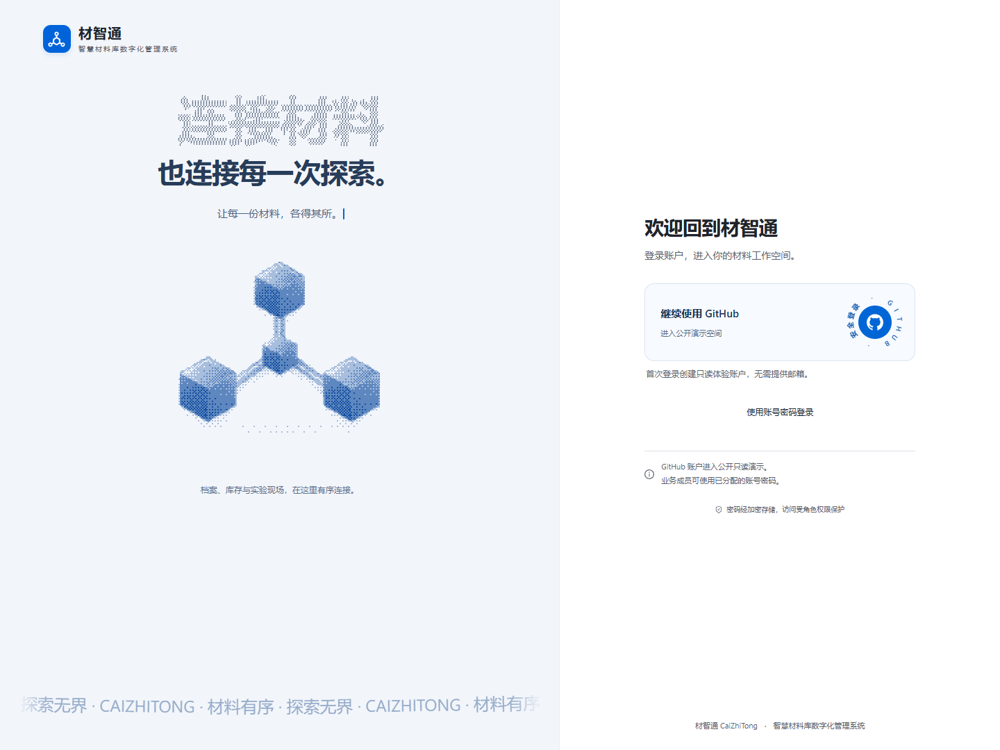
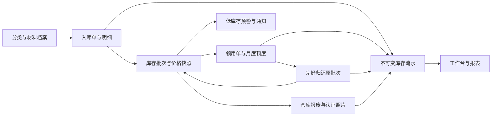
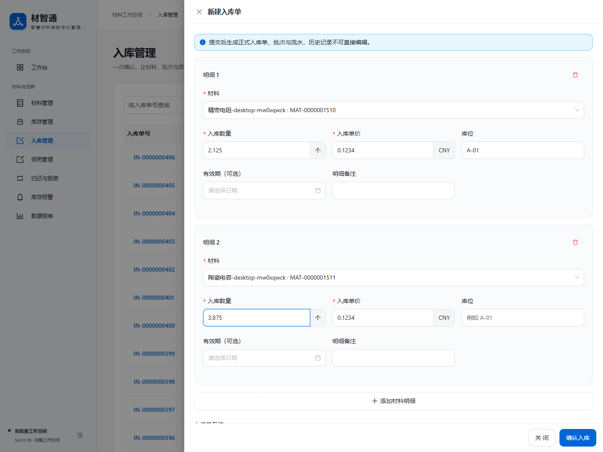
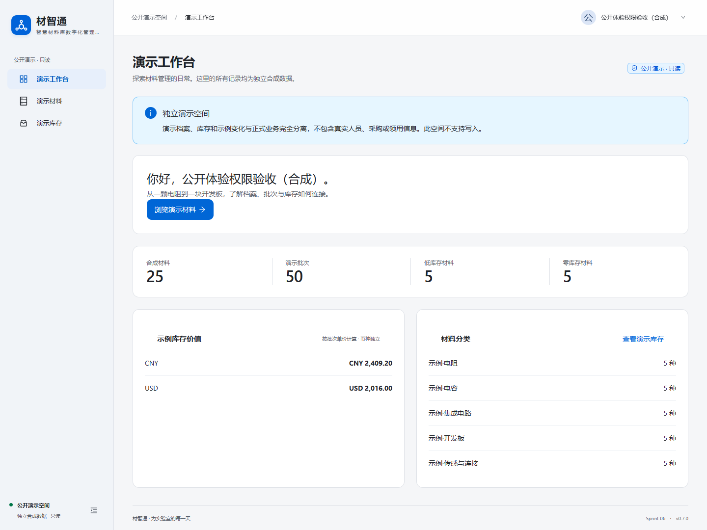
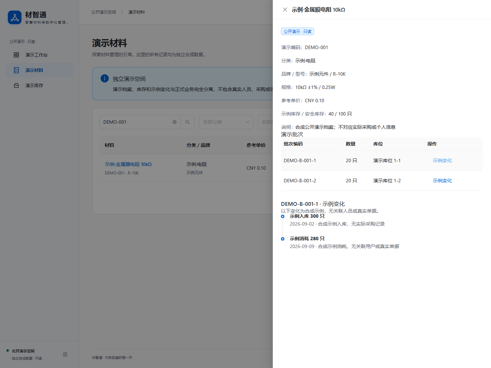
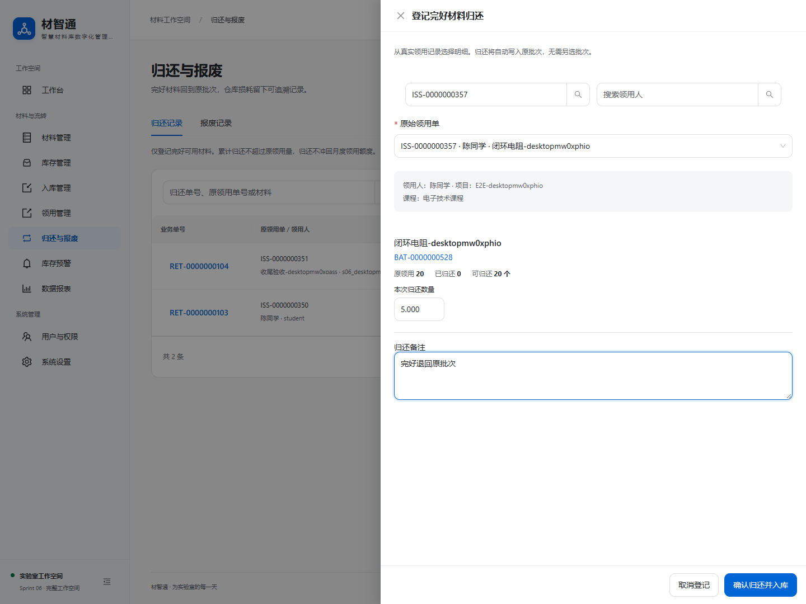
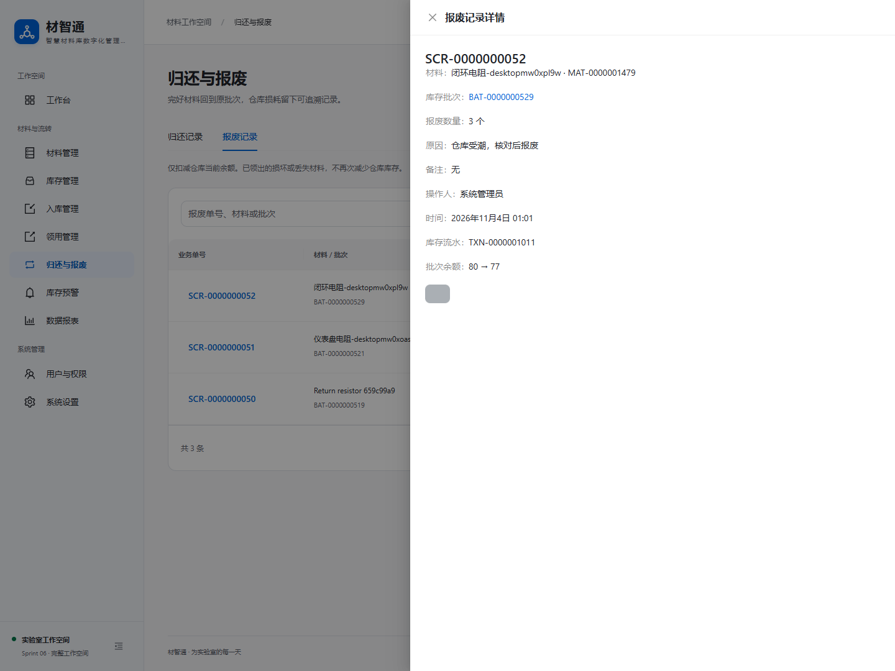
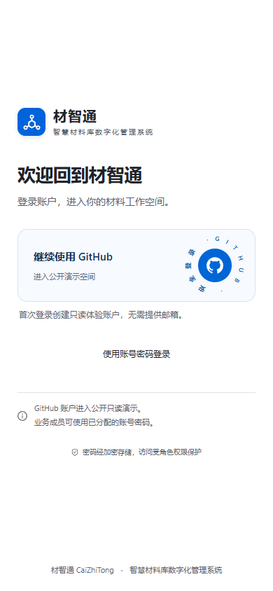
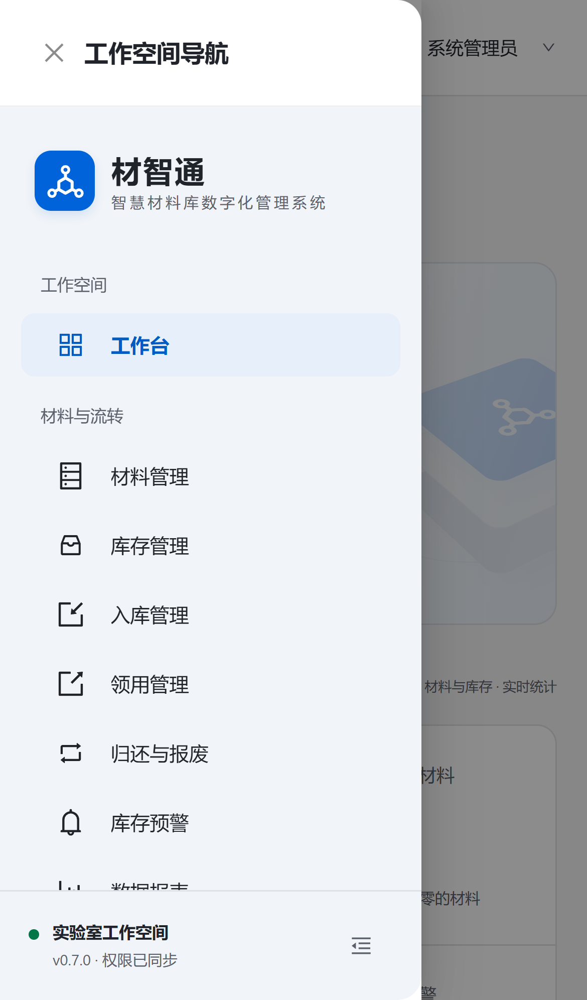

# 材智通 CaiZhiTong

**从一份材料档案，到一次有据可查的实验消耗。**

面向高校实验室的材料与库存管理系统。以 React、Spring Boot、PostgreSQL 实现材料分类、入库、批次库存、扫码领用、归还报废、低库存预警与统计报表，提供完整的中文工作空间和独立公开只读体验。

[](https://github.com/JouCristian/CaiZhiTong/actions/workflows/ci.yml)

[在线体验](https://caizhitong-eight.vercel.app) · [健康检查](https://caizhitong-api.onrender.com/actuator/health) · [贡献指南](CONTRIBUTING.md) · [API](docs/API.md) · [开发历程](docs/DEVELOPMENT.md)



## 版本冻结

**当前冻结版本：v0.7.0。** Sprint 01–06、GitHub OAuth、独立 Demo、云部署与 UI 精修均已完成验收。应用基线为 [`2e1e16e`](https://github.com/JouCristian/CaiZhiTong/commit/2e1e16e38e0f1531cf8883c530549a7b780ce381)，本轮仅补齐开源文档与协作规范，不增加功能或修改业务规则。

`v0.7.0` Git 标签固定本轮文档整理完成后的仓库快照，应用代码与上述基线一致。冻结不归档仓库，也不阻止贡献：文档与缺陷反馈继续接收，新功能和行为变更通过独立 PR 评审、归入后续版本，不移动或覆盖冻结标签。详见[版本冻结说明](docs/RELEASE-v0.7.0.md)。

这是已完成课程项目目标、可真实运行的系统。生产级审批、灾备、性能与合规能力的边界见[当前限制](#当前限制与后续方向)。

**维护说明（2026-11-08，修复候选分支）：** 后端曾出现跨网络零字节超时，经同一冻结版本重新部署后，health / OAuth 配置及正式桌面 / 手机入口已恢复。前端短时检测 / 有限重试补丁仍待 PR 人工验收，未上线；诊断和恢复证据见[专项记录](docs/FIX-LOGIN-CONNECTIVITY.md)，冻结标签不变。

## 阅读导航

- [在线体验与数据边界](#在线体验与数据边界)
- [项目特色](#项目特色)
- [功能与完整业务流程](#功能与完整业务流程)
- [角色与权限](#角色与权限)
- [界面展示](#界面展示)
- [技术栈与系统架构](#技术栈与系统架构)
- [本地快速开始](#本地快速开始)
- [环境配置](#环境配置)
- [数据库与业务规则](#数据库与业务规则)
- [测试与验收依据](#测试与验收依据)
- [项目开发历程](#项目开发历程)
- [云端部署与维护](#云端部署与维护)
- [参与贡献](#参与贡献)
- [文档索引](#文档索引)
- [版本变更记录](CHANGELOG.md)
- [当前限制与后续方向](#当前限制与后续方向)
- [许可证与第三方说明](#许可证与第三方说明)

## 在线体验与数据边界

| 入口 | 地址 / 用途 |
| --- | --- |
| 正式前端 | [caizhitong-eight.vercel.app](https://caizhitong-eight.vercel.app) |
| 后端 API | [caizhitong-api.onrender.com](https://caizhitong-api.onrender.com)，根路径不是管理页面 |
| 健康检查 | [/actuator/health](https://caizhitong-api.onrender.com/actuator/health) |

1. 打开前端，点击「继续使用 GitHub」。
2. 在 GitHub 官方页面亲自授权，首次登录自动建立仅有 `GUEST` 角色的账户。
3. 进入「演示工作台」，浏览合成材料、库存汇总、批次与示例变化，体验搜索、筛选、分页和详情。
4. 正式业务成员使用次级「使用账号密码登录」入口，或由管理员明确分配正式角色。

**公开体验只读，与正式业务隔离。** Demo 使用独立 `demo_*` 表及服务端 API，不读取正式材料、库存、个人领用、财务报表或私人附件。游客不能执行入库、领用、报废和系统管理；直接调用正式业务 API 同样返回 403，不能自行提权，也不会因相同邮箱或用户名接管既有账户。

网站不提供通用公网管理员或业务演示密码。请勿上传真实学生、采购或财务资料，完整写入流程在自己的本地库体验。Render Free 休眠后的首次连接可能需要 2–3 分钟，界面会提示等待；免费平台不提供可用性保证。

## 项目特色

- **真实闭环**：界面操作连接 Spring Boot 和 PostgreSQL，材料、单据、批次、流水与报表相互关联。
- **库存与金额一致**：库存来自批次余额，精确十进制和历史价格快照避免成本漂移，不混加币种。
- **写入可靠**：事务、排序行锁、条件更新、持久幂等；网络中断后重试相同请求不会重复计量。
- **服务端权限**：六角色、每请求实时授权、会话撤销；学生仅访问本人私有业务。
- **过程可追溯**：六轮 Sprint、发布、云适配、OAuth 隔离、UI 精修保留实际决策、失败修复和验证记录。
- **统一交互**：Apple 风格浅色、系统蓝、响应式列表与抽屉；React Bits 登录动效、自有标识、静态回退与减少动态效果支持。

## 功能与完整业务流程

| 模块 | 已完成能力 | 关键边界 |
| --- | --- | --- |
| 认证 | 密码 / BCrypt、JWT、GitHub OAuth、状态恢复、退出和失效处理 | 无公网管理员注册，OAuth 首次仅 GUEST |
| 公开体验 | 独立工作台、25 种材料、50 个批次、100 条示例变化 | 合成数据真实存库，只读，不纳入正式统计 |
| 工作台 | 库存价值、低库存、本月领用 / 净消耗、TOP10、趋势、资金占比、授权排行 | 按角色裁剪，空数据不填假指标 |
| 分类 | 大类 / 子类、树形浏览、增改删、排序、父子 / 循环校验 | 基础分类最多两层，品牌 / 型号由属性聚合为展示节点 |
| 材料档案 | 唯一自动编码、品牌型号、规格、单位、单价、币种、安全库存、启停归档 | 服务端查询分页，不能直接编辑库存 |
| 入库 | 多明细、库位、有效期、备注、单据和价格快照 | 单据、批次、IN 流水同事务，UUID 幂等 |
| 库存 | 汇总、批次余额、库存状态、流水、二维码、打印标签 | 二维码包含批次公开路由，不含密码或 JWT |
| 领用 | 扫码 / 批次入口、手工选择、核对提交、月额度、历史、中文 PDF | 后端确定当前领用人，校验库存和额度 |
| 归还 | 原单查询、多次 / 部分完好归还、原批次回库、历史与详情 | 累计不超领用量，不返还月度额度 |
| 报废 | 仓库余额报废、原因、照片、不可变历史 | 不重复扣已领出材料，照片认证读取 |
| 预警 | 周期事件、确认、恢复、扫描、通知结果与重试 | 无 SMTP 如实显示 NOT_CONFIGURED，邮件失败不回滚库存 |
| 报表 | 学期耗材、经费对应、个人明细；预览和六种 XLSX / PDF 导出 | 同口径，最多 10,000 行，不是学校财务接口 |
| 用户权限 | 搜索分页、创建编辑、角色分配、启停、重置密码、最近登录 | 仅管理员，保护自身和最后有效管理员 |
| 系统设置 | 名称 / 描述、时区、学期范围、收件人、通知状态 | 仅管理员修改，不返回服务端秘密 |

### 一份材料如何流转



本地可创建分类和材料，入库 100、领用 20、归还 5、仓库报废 3，最终余额应为 **82**。这是实际云验收用例，不代表在线游客拥有写权限。

领用 PDF 来自持久化单据快照，报表从真实单据与归还日期聚合。修改档案单价不追改历史成本，归档不删除历史关联。

## 角色与权限

| 角色 | 编码 | 典型能力 |
| --- | --- | --- |
| 游客 / 体验用户 | `GUEST` | 独立 Demo、本人身份，无正式业务访问权限 |
| 学生 | `STUDENT` | 正式材料只读、批次入口、本人领用 / 归还记录与个人报表 |
| 实验员 | `LAB_TECH` | 档案新增编辑、入库、领用管理、归还报废、预警和授权报表，无用户 / 全局设置维护权限 |
| 教师 | `TEACHER` | 材料 / 库存只读、本人领用相关业务、授权汇总与个人报表，无受限项目明细和个人排行 |
| 采购员 | `PURCHASER` | 材料 / 库存、入库历史、预警确认和授权汇总，页面可见不意味拥有入库写权限 |
| 管理员 | `ADMIN` | 全量业务、分类维护 / 档案归档、月限额、用户和系统设置 |

具体接口见 [API 权限文档](docs/API.md)及服务端授权。菜单可见不等于写权限，多角色按实际角色授权；只有 GUEST 的账户才进入 Demo 专用空间。

每请求检查数据库中的账户状态、角色和会话版本。停用 / 密码重置撤销旧 JWT，重新启用不复活旧会话，角色变更在下一请求生效。用户查询不返回密码、哈希或令牌版本。

## 界面展示

顶部登录图来自正式网站，下列业务图来自真实浏览器及隔离 PostgreSQL。样本是合成验收记录，不是硬编码指标，也不代表游客能进入正式页面。

<details>
<summary>展开工作台、材料、库存、入库、领用、报表、用户与设置</summary>

| 工作台 | 材料与分类 |
| --- | --- |
|  |  |
| 库存与批次 | 入库 |
|  |  |
| 领用与额度 | 报表 |
|  |  |
| 用户与权限 | 系统设置 |
|  |  |

</details>

<details>
<summary>展开独立 Demo、归还报废及移动端展示</summary>

| 正式站 Demo | 演示详情 |
| --- | --- |
|  |  |
| 完好归还 | 仓库报废 |
|  |  |
| 正式手机登录 | 手机导航 |
|  |  |

</details>

原图见 [screenshots](docs/screenshots/README.md)，真实 Excel / PDF 样本见 [examples](docs/examples/README.md)。静态图不能呈现动效，详见 [UI 精修](docs/UI-POLISH-01.md)。移动端以 Chromium 模拟验证，不等同于真机 Safari。

## 技术栈与系统架构

| 层次 | 技术 |
| --- | --- |
| 前端 | React 19、TypeScript 5.9、Vite 7、React Router 7 |
| 视觉 | Ant Design 5 定制 Token、独立 CSS、GSAP / Motion / OGL、React Bits |
| 后端 | Java 17、Spring Boot 3.5、Spring Security、OAuth2 Client、Nimbus JWT |
| 数据访问 | MyBatis-Plus、Spring JDBC / JdbcTemplate、Spring 事务 |
| 数据与精度 | PostgreSQL 15、Flyway V1–V7、NUMERIC / BigDecimal / Decimal.js |
| 导出与二维码 | Apache POI、PDFBox、OFL 中文字体、ZXing |
| 文件与通知 | 本地文件 / Supabase 私有 Storage、ImageIO / WebP、Jakarta Mail |
| 验证 | JUnit / MockMvc、真实 PostgreSQL、Playwright、Docker 冒烟 |
| 部署 | GitHub Actions、Vercel、Render Free、Supabase |

实际依赖版本以 `frontend/package-lock.json` 和 `backend/pom.xml` 为准。

```mermaid
flowchart TB
    User[浏览器] --> Front[React SPA / Vercel]
    Front -->|HTTPS JSON 与认证文件流| Backend[Spring Boot 单体 / Render]
    User -->|亲自授权| GitHub[GitHub OAuth]
    GitHub -->|授权码回调| Backend
    Backend --> Auth[JWT 与实时权限]
    Auth --> Formal[正式业务服务]
    Auth --> Demo[独立只读 Demo 服务]
    Formal --> DB[(PostgreSQL 私有业务 Schema)]
    Demo --> DemoTables[(同库独立 demo_* 表)]
    Formal --> Storage[Supabase 私有 Storage]
    Formal --> Export[Excel / PDF / 二维码]
    Formal -->|事务提交后| SMTP[可选 SMTP]
```



前后端分离、后端单体，不依赖 Redis、消息队列或微服务。MyBatis-Plus 承担既有 CRUD，聚合 Mapper 以同一数据源的预编译 JdbcTemplate SQL 共享事务。前端只调用 Spring Boot，不直接用 Supabase Key 读取业务表或私有照片。

### 工程目录

```text
frontend/
  src/                 路由、认证、主题与业务页面
    materials/         分类与材料档案
    stock/             库存、批次与入库
    issues/            领用与额度
    operations/        归还、报废、预警、报表
    admin/             用户与设置
    demo/              独立只读体验
    motion/            登录视觉与共享抽屉动效
  e2e/                 原业务、权限、侧栏与抽屉测试
  e2e-oauth/           Mock OAuth、Demo 隔离与视觉测试
backend/
  src/main/java/cn/caizhitong/
                       Controller / Service / Mapper / Entity / DTO / Security
  src/main/resources/db/migration/
                       已执行的 V1–V7 Flyway 迁移
  src/main/resources/db/demo/
                       独立合成 Demo 初始化
  src/test/            真实 PostgreSQL 集成测试
database/              数据库说明、开发档案 SQL
scripts/               启动、便携数据库、隔离测试和审计
docs/                  API、验收、日志、部署、截图、样本
.github/               CI、PR 模板与 Issue 模板
CONTRIBUTING.md        Fork、分支、测试、PR、评审
SECURITY.md            安全问题私密反馈与保密要求
```

## 本地快速开始

### 环境要求

| 工具 | 要求 / 已验证环境 |
| --- | --- |
| Git | 克隆、分支和 PR |
| Node.js | 推荐 **24.22.1**，本地及 CI 已验证；Vite 要求 Node 22.12+ 或兼容较新版本 |
| npm | 随 Node 安装，使用 npm ci 和锁文件 |
| JDK | **17**；本机 OpenLogic **17.0.20+8**，CI Temurin 17 |
| Maven | **3.9.16 Wrapper**，无需全局 Maven |
| PostgreSQL | **15**；本机便携版 **15.15**，CI PostgreSQL 15 |
| PowerShell | Windows PowerShell 5.1+，推荐 7 |
| 浏览器 | 现代浏览器，自动化用 Chrome / Playwright Chromium |
| Docker | 可选数据库 / 镜像验证，一键本地运行不强制要求 |

首次安装需访问 npm、Maven Central 与数据库下载源。主要本地脚本面向 Windows；Linux CI 已验证构建、数据库测试、Mock OAuth，其他桌面系统的一键启动未逐一验证。

### 1. 克隆与初始化

在自己的工作目录执行，`JAVA_HOME` 先指向自己的 JDK 17：

```powershell
git clone https://github.com/JouCristian/CaiZhiTong.git
Set-Location ./CaiZhiTong
node --version
$env:Path = "$env:JAVA_HOME/bin;$env:Path"
java -version
./backend/mvnw.cmd -v

# 仅当前 PowerShell 会话有脚本策略限制时使用。
Set-ExecutionPolicy -Scope Process Bypass
./scripts/setup-local.ps1
Copy-Item ./frontend/.env.example ./frontend/.env
npm.cmd --prefix frontend ci
./scripts/portable-postgres.ps1 start
```

首次生成随机数据库密码、JWT 密钥和三个账户密码，写入忽略的根 `.env`；已存在时保留。便携数据库仅监听本机，数据在忽略的 `.runtime/pgdata`。

已有项目不要覆盖自己的环境文件。选择 Docker 时，以 `docker compose up -d` 替代便携数据库启动，不同时占用 5432。Compose 仅提供数据库，不包含前后端容器。

### 2. 启动

终端 A，仓库根目录：

```powershell
./scripts/start-backend.ps1
```

终端 B，同一仓库根目录：

```powershell
npm.cmd --prefix frontend run dev
```

| 入口 | 地址 |
| --- | --- |
| 本地前端 | http://127.0.0.1:5173 |
| 本地健康 | http://127.0.0.1:8080/actuator/health |

首次启动自动执行 Flyway。Vite 代理 `/api`、`/oauth2` 和后端 OAuth 回调，无需把生产数据库或 GitHub Secret 放到前端。

### 3. 登录与可选开发数据

| 用户名 | 角色 | 密码变量 |
| --- | --- | --- |
| admin | 管理员 | DEMO_ADMIN_PASSWORD |
| lab | 实验员 | DEMO_LAB_PASSWORD |
| student | 学生 | DEMO_STUDENT_PASSWORD |

在自己的编辑器中打开忽略的根 `.env` 查看密码，不粘贴到 Issue、PR、截图或共享日志。仅 dev profile + DEMO_ENABLED=true 补建缺失账户，不覆盖原密码或角色；修改环境变量不重置管理员改过的密码。

日常本地库没有正式库存，可通过界面走完整业务。迁移完成后可选执行：

```powershell
./scripts/seed-demo.ps1
```

该脚本仅在明确启用的开发环境写十份档案，不创建正式库存；与启动时初始化的独立 `demo_*` 公开目录是两套数据。

### 4. 停止与构建

启动终端 Ctrl+C 停止前后端；数据库用 `./scripts/portable-postgres.ps1 stop` 或 `docker compose stop`，保留数据。配置改动后重启服务，不为修配置删除数据库。

```powershell
# 先按测试章节准备独立测试库，从仓库根目录执行。
. ./scripts/load-env.ps1
Push-Location ./backend
./mvnw.cmd -B verify
Pop-Location
npm.cmd --prefix frontend run typecheck
npm.cmd --prefix frontend run build
```

Windows 重新打包运行中的同名 JAR 前应停止对应进程，避免文件锁。前端本地预览用 `npm.cmd --prefix frontend run preview -- --port 5173 --strictPort`，仍需真实后端，不是云部署命令。

## 环境配置

| 文件 | 读取方式 |
| --- | --- |
| 根 [.env.example](.env.example) → .env | PowerShell 启动 / 测试脚本读取 |
| [frontend/.env.example](frontend/.env.example) → frontend/.env | Vite 读取，VITE_ 变量进入浏览器 |
| [.env.cloud.example](.env.cloud.example) | 云端参考，本地脚本不自动加载 .env.cloud |

**Spring Boot 不自行读取根 `.env`。** 先用脚本加载再启动 Maven，或在 IDE 设置变量。生产秘密只放后端平台，不放 Docker 构建参数、源码或 VITE_ 变量。

| 组别 | 变量 | 作用 / 边界 |
| --- | --- | --- |
| 数据库 | DB_URL、DB_USERNAME、DB_PASSWORD | JDBC 地址，URL 不嵌入凭据 |
| Schema / 池 | DB_SCHEMA、DB_POOL_MAX、DB_POOL_MIN | 本地 public，云端私有 caizhitong，池上限 3 |
| 迁移 | FLYWAY_DB_URL、FLYWAY_DB_USERNAME、FLYWAY_DB_PASSWORD | 独立连接，缺省继承运行凭据 |
| JWT | JWT_SECRET、JWT_TTL_SECONDS | Base64 解码至少 32 随机字节，默认 7200 秒 |
| 网络 | SERVER_PORT、CORS_ALLOWED_ORIGINS、PUBLIC_WEB_URL | 精确前端源、端口、二维码公开域名 |
| 业务 | BUSINESS_TIME_ZONE | 初始 Asia/Shanghai，库存业务后锁定时区 |
| 开发账户 | DEMO_ENABLED、DEMO_*_PASSWORD | 仅开发，生产 false |
| 管理员 | BOOTSTRAP_ADMIN_* | 无有效管理员时受控初始化，成功后关闭并删除一次性密码 |
| 照片 | STORAGE_MODE、STORAGE_ROOT | local / supabase，切换不自动搬迁旧文件 |
| Storage | SUPABASE_URL、SUPABASE_STORAGE_BUCKET、SUPABASE_STORAGE_KEY | 仅后端，私有 Bucket |
| OAuth | GITHUB_OAUTH_ENABLED、GITHUB_CLIENT_ID、GITHUB_CLIENT_SECRET、GITHUB_REDIRECT_URI | 本地默认关闭，Secret 仅后端 |
| 通知 | MAIL_*、ALERT_SCAN_ENABLED | SMTP 可选，缺失不影响站内预警 |
| 前端 | VITE_API_BASE_URL | 后端源，无 /api 后缀，本地留空走代理 |
| 超时 | VITE_API_TIMEOUT_MS | 本地 12000 ms，正式 Free 环境 240000 ms |
| 代理 | API_PROXY_TARGET | 仅 Vite，默认 http://127.0.0.1:8080 |

本地 OAuth 优先 Mock Provider，无需真实个人资料。自建 App 的 Homepage / 回调、state / PKCE、一次性交换见 [OAuth 配置](docs/V0.7.0-GITHUB-OAUTH.md)。不将维护者生产 App 用于自己的 Fork。

## 数据库与业务规则

| 迁移 | 主要结构 | 阶段 |
| --- | --- | --- |
| V1 | sys_user、sys_role、sys_user_role | 认证六角色 |
| V2 | material_category、material_item、编码序列 | 分类档案 |
| V3 | 入库单 / 明细、stock_batch、stock_transaction | 入库批次流水 |
| V4 | 领用单 / 明细、月度用量、价格快照 | 领用额度 |
| V5 | 归还、报废、附件、预警、通知、课程 | 流转报表 |
| V6 | 最近登录、会话版本、app_settings | 用户设置 |
| V7 | OAuth 身份 / 交换码、密码入口、四张 demo_* 表 | 公开体验 |

原文件见[迁移目录](backend/src/main/resources/db/migration)，详细约束见[数据库说明](database/README.md)。**V1–V7 是已执行历史，不得改名、改写、重排或用 repair 掩盖差异。** 后续仅追加经评审的新版本。

Demo 以固定合成记录、事务锁及 ON CONFLICT DO NOTHING 幂等初始化，重启不清空 / 重置已有记录；关联仅限 Demo，不回退正式表。

关键口径：

- 批次余额是库存来源，安全库存仅为预警阈值。
- 单据、余额、不可变流水同事务；相同幂等键 / 内容恢复原结果，冲突内容不得伪装成功。
- 归还进入原批次，累计不超原领用，不返还自然月额度；报废只扣仓库余额。
- 总库存严格低于阈值才预警，阈值 0 不预警；持续低库存一个周期，恢复再降低形成新周期。
- 数量 / 金额 JSON 为十进制字符串，NUMERIC、BigDecimal、Decimal.js / stringMode 协作。
- 不同币种不相加，数量按单位分组，领用使用批次单价快照。
- 净消耗按本期领用减本期实际归还，可跨期为负；资金占比为领用金额，未扣归还；报废单列。
- 学期配置影响默认范围，自定义日期优先；库存业务后时区锁定。
- 导出最多 10,000 行，XLSX 超精度数值按文本保存，合计由后端计算。

## 测试与验收依据

### 自己的隔离环境

推荐 Windows 便携 PostgreSQL 路径，8081 / 5180 / 9098 无其他测试占用：

```powershell
./scripts/portable-postgres.ps1 test-db
./scripts/test-backend.ps1

. ./scripts/load-env.ps1
Push-Location ./backend
./mvnw.cmd -B verify
Pop-Location
npm.cmd --prefix frontend run typecheck
npm.cmd --prefix frontend run build
./scripts/test-browser.ps1
./scripts/test-browser.ps1 -OAuthMock

python ./scripts/audit-release.py
./scripts/check-release.ps1
```

审计另需 Python 3。普通套件执行五组 API 冒烟与 70 项业务 / 动效用例，OAuthMock 执行 18 项认证 / Demo / 视觉用例。CI 另在 Mock 环境跑 6 项侧栏 / 抽屉测试，不能将远程 24 项说成远程全量 70 项。

默认 Chrome，可设置 E2E_BROWSER_EXECUTABLE 为浏览器完整路径，或在 frontend 安装 Playwright Chromium 并设置 E2E_BROWSER_CHANNEL=chromium。

后端仅接受 _test 数据库，使用 caizhitong_test 与 caizhitong_v070_demo_e2e_test。浏览器会重置专用夹具、保留账户与迁移，拒绝占用端口，不关闭用户已有服务。一键浏览器脚本依赖便携库逻辑，Docker 用户先阅读[贡献指南](CONTRIBUTING.md)，不要同时启动便携实例。

### 实际结果

| 范围 | 结果与依据 |
| --- | --- |
| 冻结应用基线 CI | [41954664321](https://github.com/JouCristian/CaiZhiTong/actions/runs/41954664321)，对应 2e1e16e，成功 |
| 后端 | Maven **195/195**，真实 PostgreSQL，0 失败 / 错误 / 跳过 |
| CI 浏览器 | OAuth / Demo / 视觉 **18/18**，侧栏 / 抽屉 **6/6** |
| CI 构建 | npm ci、类型检查、生产构建、Docker、512 MiB 健康 / 401 / OOM 检查通过 |
| 本地完整业务 | **70/70**；进入动画最终修复后专项 **6/6**，未冒称再次全量跑 70 |
| 线上 UI 与业务保全 | **29 项**，包含桌面 / 手机、管理员登录、原库存、私有照片哈希 |
| 重部署持久化 | 另 **6 次 HTTP** 检查，健康 UP、前端 HTTP 200 |

数字对应相应阶段，不是每次提交自动运行的总数；最新看 CI 徽章。命令与修复见 [UI 精修](docs/UI-POLISH-01.md)、[生产 OAuth](docs/CLOUD-DEPLOYMENT-03.md)、[冻结记录](docs/RELEASE-v0.7.0.md)。真实 GitHub 授权由持有人亲自完成，Mock 不等于重新执行真实授权。

## 项目开发历程

先以六轮 Sprint 完成本地业务与人工验收，再源码发布、云适配、公开登录隔离和 UI 精修。以下为**开发阶段记录**，不伪造 Git Commit 时间线；首次公开前的过程保存在日志中。

| 阶段 | 成果 | 记录 |
| --- | --- | --- |
| Sprint 01 | 工程、PostgreSQL、V1、BCrypt / JWT、六角色、后台框架 | [开发日志](docs/DEVELOPMENT.md)、[历史验收](docs/ACCEPTANCE.md) |
| Sprint 02 | 分类、自动编码档案、查询分页与权限 | [Sprint 02](docs/SPRINT-02.md) |
| Sprint 03 | 多明细入库、批次、不可变流水、二维码 | [Sprint 03](docs/SPRINT-03.md)、[验收](docs/SPRINT-03-ACCEPTANCE.md) |
| Sprint 04 | 扫码领用、额度、幂等扣减、中文 PDF | [Sprint 04](docs/SPRINT-04.md)、[验收](docs/SPRINT-04-ACCEPTANCE.md) |
| Sprint 05 | 完好归还、报废、照片、预警、报表 | [Sprint 05](docs/SPRINT-05.md)、[验收](docs/SPRINT-05-ACCEPTANCE.md) |
| Sprint 06 | 用户、设置、真实仪表盘、全功能回归 | [Sprint 06](docs/SPRINT-06.md)、[最终验收](docs/FINAL-ACCEPTANCE.md) |
| v0.6.0 | 审计、许可证、Wrapper、源码公开与 CI | [发布记录](docs/RELEASE-v0.6.0.md) |
| Cloud Deployment 01 | Storage、私有 Schema、独立 Flyway、首次管理员，先本地验证 | [云适配](docs/CLOUD-DEPLOYMENT-01.md) |
| Cloud Deployment 02 | Supabase + Render + Vercel、链路与持久化 | [云部署](docs/CLOUD-DEPLOYMENT-02.md) |
| v0.7.0 / PR #1 | GitHub OAuth、独立 Demo、安全隔离、受控上线 | [开发](docs/V0.7.0-GITHUB-OAUTH.md)、[隔离](docs/DEMO-ISOLATION.md)、[生产](docs/CLOUD-DEPLOYMENT-03.md) |
| UI / PR #2 | React Bits、自有标识、侧栏与抽屉修复 | [UI 精修与发布](docs/UI-POLISH-01.md) |
| v0.7.0 冻结 | 固定基线、展示文档、贡献与 PR 规范 | [冻结说明](docs/RELEASE-v0.7.0.md)、[贡献](CONTRIBUTING.md) |

历史文档保留当时的未开发 / 未部署及失败记录，不代表冻结版仍缺少这些能力。现状先读本 README、冻结说明与最新 API 章节，再查原始过程。

## 云端部署与维护

正式方案为 **Vercel + Render + Supabase PostgreSQL / 私有 Storage**。不使用 Neon、Cloudflare R2 或 Supabase Auth，OAuth 由 Spring Security OAuth2 Client 接入。

| 平台 | 配置要点 |
| --- | --- |
| Vercel | Root frontend，npm ci / build / dist，SPA 重写避开 assets、brand，仅公开 API 与超时 |
| Render | Docker context backend、backend/Dockerfile、Java 17、平台端口和健康，受限 JVM / 池 |
| PostgreSQL | SSL Session pooler 5432、私有 Schema、独立 Flyway，不用 6543 Transaction pooler |
| Storage | 私有 caizhitong-attachments，5 MB，JPEG / PNG / WebP，仅后端鉴权代理 |
| GitHub OAuth | 后端 Secret、HTTPS 回调、固定前端回跳 |

Supabase Data API 已关闭，业务 Schema 不公开暴露。CORS、PUBLIC_WEB_URL 使用准确正式源，更换域名同步 API、OAuth、CORS 和二维码源。

**main 已连接自动部署，合并 PR 会影响正式站点。** 贡献者在本地 / 自己的 Fork 验证，不索取生产凭据。预览 READY 不等于正式上线，预览域名不自动获得生产 CORS。冻结不会自动关闭部署，也不代表已启用 GitHub 分支保护。

复现、备份边界、一次性管理员与 OAuth 恢复见 [DEPLOYMENT](docs/DEPLOYMENT.md)。

## 参与贡献

欢迎缺陷、文档、测试、无障碍和兼容性改进。涉及新业务、权限、统计口径、迁移、依赖或视觉方向，请先开 Issue 说明范围。

流程：**Fork → 最新 main 建分支 → 隔离验证 → Push 自己的 Fork → 向本仓库 main 提 PR → 评审修正 → 维护者合并。** 无需上游写权限，不直接 Push 上游 main。

- [CONTRIBUTING](CONTRIBUTING.md)：完整命令、验证、迁移与评审规则。
- [PR 模板](.github/PULL_REQUEST_TEMPLATE.md)：动机、验证、截图、兼容与安全检查。
- [缺陷反馈](https://github.com/JouCristian/CaiZhiTong/issues/new?template=bug_report.yml) / [改进建议](https://github.com/JouCristian/CaiZhiTong/issues/new?template=feature_request.yml)。
- [SECURITY](SECURITY.md)：漏洞、令牌和私有数据问题不要开公开 Issue。

不要夹带无关重排、真实用户资料、秘密、日志、产物或数据库备份。第三方组件 / 素材须说明来源与许可，项目 MIT 不覆盖第三方限制。

## 文档索引

| 需求 | 入口 |
| --- | --- |
| 冻结基线与维护边界 | [RELEASE-v0.7.0](docs/RELEASE-v0.7.0.md) |
| 贡献与提 PR | [CONTRIBUTING](CONTRIBUTING.md) |
| 接口权限 | [API](docs/API.md)，按最新章节阅读 |
| 表结构与迁移 | [数据库说明](database/README.md) |
| 开发过程 | [DEVELOPMENT](docs/DEVELOPMENT.md) |
| 部署配置 | [DEPLOYMENT](docs/DEPLOYMENT.md) |
| OAuth | [开发记录](docs/V0.7.0-GITHUB-OAUTH.md) |
| 正式 / Demo 隔离 | [DEMO-ISOLATION](docs/DEMO-ISOLATION.md) |
| 人工验收 | [最终验收](docs/FINAL-ACCEPTANCE.md)、[v0.7.0 验收](docs/V0.7.0-ACCEPTANCE.md) |
| 视觉与生产证据 | [UI-POLISH-01](docs/UI-POLISH-01.md) |
| 导出样本 | [examples](docs/examples/README.md) |
| 安全反馈 | [SECURITY](SECURITY.md) |

## 当前限制与后续方向

- 单实例课程项目，未完成生产压测、故障切换和灾难恢复演练，免费平台有休眠与配额限制。
- 无审批、库存预占、LDAP、AI 预测、小程序或独立采购订单；采购员角色不等于采购审批系统。
- JWT 无刷新令牌或逐设备撤销，到期重新登录；OAuth 内存握手在重启时需重新发起。
- 无真实 SMTP 时不宣称外部投递成功，发送中断可能留下 SENDING，需核查。
- 取消报废可能留下未关联照片，暂不自动清理；数据库与附件分别备份，切换存储不自动迁移。
- 通用财务模板未对接学校系统，不是正式会计或审计系统。
- 未覆盖所有真机浏览器，Ant Design 公共块仍有体积提示。
- React Bits 含 Commons Clause，不能将全部第三方文件理解为无额外限制的 MIT。

审计记录、附件清理、备份恢复、更多浏览器与性能优化属于候选方向，不是冻结版已实现能力或本轮开发承诺。

## 许可证与第三方说明

项目自有代码采用 [MIT](LICENSE)，同时遵守独立许可：

| 组件 / 素材 | 许可 |
| --- | --- |
| React Bits 源文件 | [MIT + Commons Clause](frontend/src/motion/reactbits/LICENSE.md)，保留[来源和修改](frontend/src/motion/reactbits/NOTICE.md)，不由项目 MIT 重新授权 |
| 中文字体 | OFL，见[字体说明](backend/src/main/resources/fonts/README.md) |
| Maven Wrapper | [Apache-2.0](backend/.mvn/wrapper/LICENSE) |
| 其他依赖 | 遵循各自许可证，版本见锁文件与 Maven 配置 |

项目使用自有标识。GitHub 标识用于认证入口，Apple 风格仅指设计方向，不代表相关品牌的官方合作或背书。
